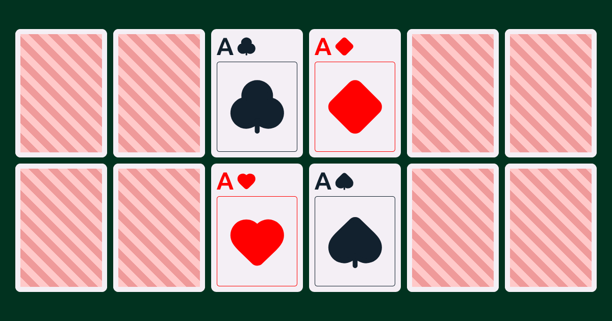

<p align="center">
  
</p>

<h1 align="center">Play Cards</h1>

<p align="center">
  <i>
  Play multiplayer card games online with friends.
  </i>
</p>

<p align="center">
  <a href="https://playcards.games">
    
  </a>
</p>

<p align="center">
  <a href="#about">About</a>
  | <a href="#getting-started"">Getting Started</a>
  | <a href="#contributing">Contributing</a>
</p>

## About

Play Cards is a browser-based platform for playing classic card games in real time with friends. Start a game, share the lobby link, and everyone joins from their own device — no sign-up, no install.

Hosted at **[https://playcards.games](https://playcards.games)**.

### Games

| Game          | Description                                                                                    |
|:--------------|:-----------------------------------------------------------------------------------------------|
| **High Card** | (Test game) High Card is a simple luck-based game where the player with the highest card wins. |
| **Yaniv**     | Win hands of 7 points or under and call Yaniv!                                                 |

## Tech Stack

Built with the [T3 Stack](https://create.t3.gg/), extended for real-time multiplayer:

| Layer      | Technology                                                                            |
|------------|---------------------------------------------------------------------------------------|
| Language   | [TypeScript](https://www.typescriptlang.org/)                                         |
| Framework  | [Next.js](https://nextjs.org) (App Router)                                            |
| API        | [tRPC](https://trpc.io) with server-sent events for game state updates                |
| Styling    | [Tailwind CSS](https://tailwindcss.com)                                               |
| Game state | [Redis](https://redis.io/) via [ioredis](https://github.com/redis/ioredis)            |
| Containers | [Docker](https://www.docker.com/) + [Caddy](https://caddyserver.com/) (reverse proxy) |
| Testing    | [Vitest](https://vitest.dev/) (unit) · [Playwright](https://playwright.dev/) (E2E)    |
| Linting    | [Biome](https://biomejs.dev/)                                                         |


## Getting Started

### Prerequisites

Exact versions are specified in the [tool-versions](./.tool-versions) file. Tools like [asdf](https://asdf-vm.com/guide/getting-started.html) can help with managing the versions.

- [Node.js](https://nodejs.org/) v22
- [pnpm](https://pnpm.io/) v10
- [Docker](https://www.docker.com/)

### Running Locally

1. Install dependencies:

    ```bash
    pnpm install
    ```

2. Start the development server (Next.js + Redis in Docker):

    ```bash
    pnpm dev
    ```

    Open [http://localhost:3000](http://localhost:3000) in your browser.

### Other Scripts

| Command                               | Description                    |
|:--------------------------------------|:-------------------------------|
| `pnpm build`                          | Make a production build        |
| `docker build -t card-games .`        | Make a production docker build |
| `pnpm test`                           | Run unit tests                 |
| `pnpm test:integration`               | Run integration tests          |
| `pnpm --flilter @repo/web test:e2e`   | Run E2E tests (headless)       |
| `pnpm --filter @repo/web test:e2e:ui` | Run E2E tests (With UI)        |
| `pnpm typecheck`                      | Verify types                   |
| `pnpm format:check`                   | Verify formatting              |
| `pnpm format:fix`                     | Fix formatting issues          |

## Contributing

Contributions are welcome! A few guidelines to keep things smooth:

- **Open an issue before a pull request** — This helps avoid wasted effort and ensures the change is likely to be accepted before you invest time in it.
- **Keep changes small and focused** — One thing per PR makes review faster and reduces the chance of conflicts.
- **Game rules are intentionally opinionated** — Bug reports and fun/balance suggestions are welcome, but variations on rules are unlikely to be accepted at this time.

If you've spotted a bug or have a suggestion, please [open an issue](https://github.com/alastair-smith/card-games/issues).
