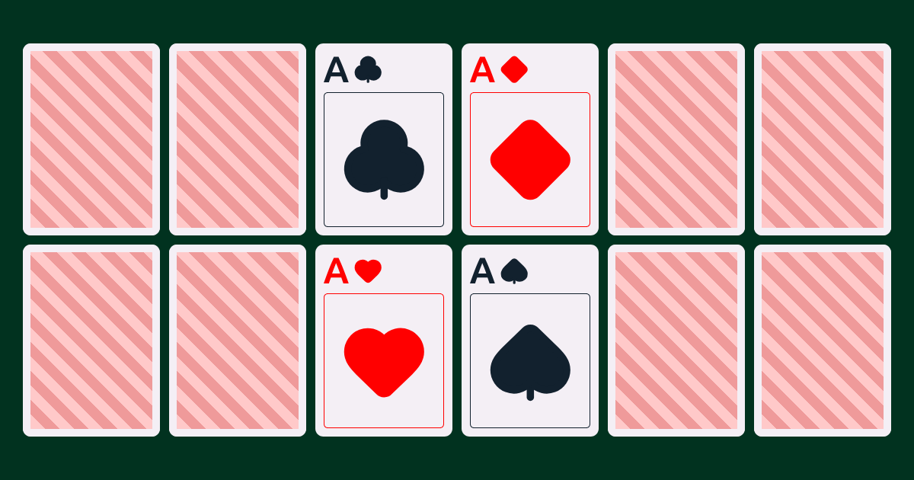

  

<h1 align="center">Play Cards</h1>

  <i>
  Play multiplayer card games online with friends.
  </i>

  

  <a href="#about">About</a>
  | <a href="#contributing">Contributing</a>
  | <a href="#licence">Licence</a>

## About

Play Cards is a browser-based platform for playing classic card games in real time with friends. Start a game, share the lobby link, and everyone joins from their own device — no sign-up, no install.

Hosted at **[https://playcards.games](https://playcards.games)**.

- **Docs:** how the app is built and how each game works, at [docs.playcards.games](https://docs.playcards.games)
- **Storybook:** the app's components and screens, at [stories.playcards.games](https://stories.playcards.games)

### Games

| Game          | Description                                                                                    |
| :------------ | :--------------------------------------------------------------------------------------------- |
| **High Card** | (Test game) High Card is a simple luck-based game where the player with the highest card wins. |
| **Yaniv**     | Win hands of 7 points or under and call Yaniv!                                                 |

## Tech Stack

Built with the [T3 Stack](https://create.t3.gg/), extended for real-time multiplayer:

| Layer      | Technology                                                                         |
| ---------- | ---------------------------------------------------------------------------------- |
| Language   | [TypeScript](https://www.typescriptlang.org/)                                      |
| Framework  | [Next.js](https://nextjs.org) (App Router)                                         |
| API        | [tRPC](https://trpc.io) with server-sent events for game state updates             |
| Styling    | [Tailwind CSS](https://tailwindcss.com)                                            |
| Game state | [Redis](https://redis.io/) via [ioredis](https://github.com/redis/ioredis)         |
| Hosting    | [Render](https://render.com/)                                                      |
| Testing    | [Vitest](https://vitest.dev/) (unit) · [Playwright](https://playwright.dev/) (E2E) |
| Linting    | [Biome](https://biomejs.dev/)                                                      |

## Contributing

Contributions are welcome! A few guidelines to keep things smooth:

- **Open an issue before a pull request** — This helps avoid wasted effort and ensures the change is likely to be accepted before you invest time in it.
- **Keep changes small and focused** — One thing per PR makes review faster and reduces the chance of conflicts.
- **Game rules are intentionally opinionated** — Bug reports and fun/balance suggestions are welcome, but variations on rules are unlikely to be accepted at this time.

If you've spotted a bug or have a suggestion, please [open an issue](https://github.com/alastair-smith/card-games/issues/new/choose).

## Licence

Copyright (C) 2026 Alastair Smith

This program is free software: you can redistribute it and/or modify it under the terms of the GNU Affero General Public License as published by the Free Software Foundation, either version 3 of the License, or (at your option) any later version.

This program is distributed in the hope that it will be useful, but WITHOUT ANY WARRANTY; without even the implied warranty of MERCHANTABILITY or FITNESS FOR A PARTICULAR PURPOSE. See the [GNU Affero General Public License](./LICENSE.md) for more details.
