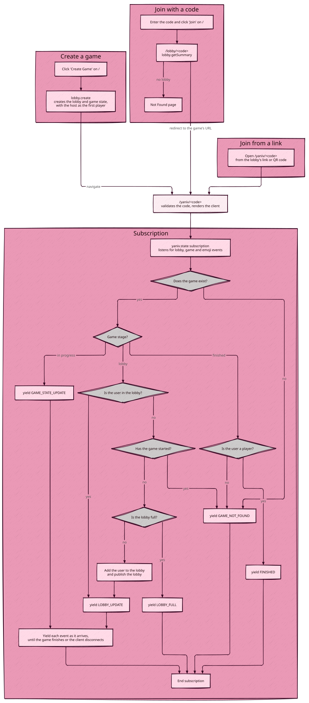
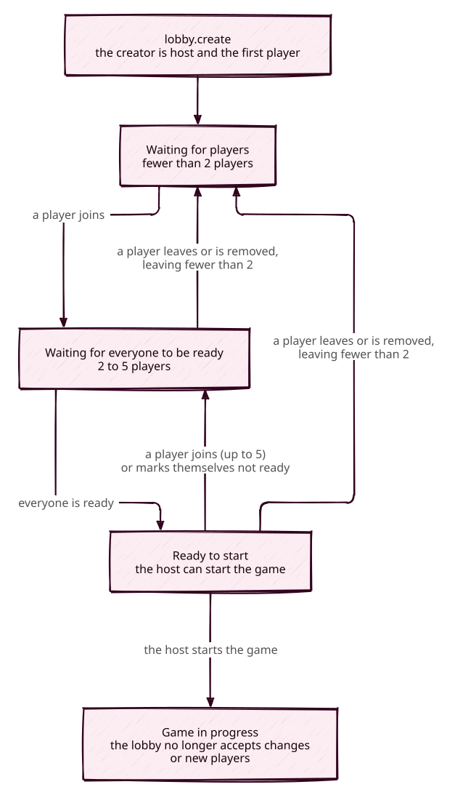

# Lobby

## Joining a game

## Lifecycle

Until the game starts, players can change the lobby:

| Who          | Can                                                                                                                             |
| ------------ | ------------------------------------------------------------------------------------------------------------------------------- |
| The host     | Change the [Yaniv settings](./yaniv.md#settings) (Shithead has none), make another player host, remove a player, start the game |
| Every player | Change their name, change their colour if no one else has it, mark themselves ready or not, leave                               |

When the host leaves, the player who has been in the lobby longest becomes host. When the
last player leaves, the lobby is deleted.
